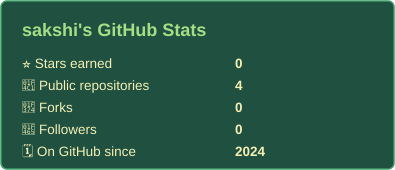
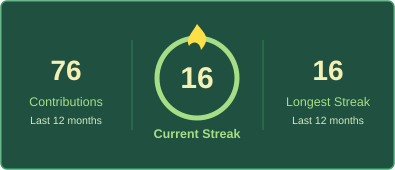
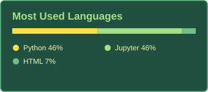

 

## 🏡 About Me

I'm Sakshi, an MSc student in Big Data Analytics who likes building real, practical solutions, not just learning theory. My work spans data analytics, machine learning pipelines, data mining and business-focused problem solving.

| | |
|---|---|
| 🗡️ **Current Project** | <!--CURRENT_START-->[bioinformatics journal](https://github.com/fleur12/bioinformatics-journal)<!--CURRENT_END--> |
| 📜 **Currently Learning** | Clustering (K-Means, DBSCAN), Flask REST APIs and data visualization |
| 💬 **Ask Me About** | Data analytics, data mining, machine learning, Python, Spark and Flask |
| 📖 **Next Chapter** | Preparing for Data Analyst / Data Scientist roles |

## 🚀 Recent Projects

*This table updates itself: the newest repository becomes the Current Project above, and the list is ordered by latest activity.*

<!--PROJECTS_START-->
| Project | About | Language | Updated |
|---|---|---|---|
| [**bioinformatics-journal**](https://github.com/fleur12/bioinformatics-journal) | Shire-themed interactive journal of 12 bioinformatics practicals with a live sequence aligner, BLAST tables, structure, pathway and phylogeny results | HTML | 18 Nov 2026 |
| [**CRM-Data-Health-Assessment-using-Apache-Spark-Machine-Learning**](https://github.com/fleur12/CRM-Data-Health-Assessment-using-Apache-Spark-Machine-Learning) | CRM data quality, anomaly detection (Isolation Forest) and K-Means customer segmentation on 7,043 Telco records with PySpark | Jupyter Notebook | 12 Nov 2026 |
| [**data-mining**](https://github.com/fleur12/data-mining) | 7 MSc practicals covering aggregation, PCA, feature selection, class imbalance and Apriori association rules | Python | 02 May 2026 |
| [**basic-mongo-flask**](https://github.com/fleur12/basic-mongo-flask) | Full-stack Flask + MongoDB Atlas web app with live CRUD through HTML forms | HTML | 07 Oct 2025 |
<!--PROJECTS_END-->

### ✨ Project Highlights

**🧬 [Bioinformatics Practical Journal](https://github.com/fleur12/bioinformatics-journal)** · *Newest* · [Live site](https://fleur12.github.io/bioinformatics-journal/)
> An interactive, Shire-themed journal of 12 MSc bioinformatics practicals, from sequence databases and BLAST to structures, pathways and phylogeny.

Each practical has its aim, procedure, results, discussion and viva, plus an in-browser pairwise aligner and drawn p53 tree and pathway. **Stack:** `HTML` `CSS` `JavaScript` `Clustal Omega` `Kalign` `BLAST` `PyMOL`

**🩺 [CRM Data Health Assessment](https://github.com/fleur12/CRM-Data-Health-Assessment-using-Apache-Spark-Machine-Learning)**
> Data quality checks, anomaly detection and customer segmentation on 7,043 IBM Telco customer records.

Applies PySpark preprocessing and validation, an Isolation Forest anomaly-based Customer Health Score, and K-Means segmentation. **Stack:** `Python` `Apache Spark` `PySpark` `Spark MLlib` `scikit-learn` `Databricks` `Pandas` `Matplotlib`

**⛏️ [Data Mining Practicals](https://github.com/fleur12/data-mining)**
> Seven hands-on practicals covering the full data mining pipeline, from raw data to patterns.

Data aggregation, integration and transformation, PCA, feature transformation, feature selection, class imbalance and Apriori association rule mining. **Stack:** `Python` `Pandas` `NumPy` `scikit-learn` `mlxtend` `imbalanced-learn` `Seaborn`

**🌐 [Basic MongoDB Flask Project](https://github.com/fleur12/basic-mongo-flask)**
> Full-stack web app with Flask and MongoDB Atlas, with CRUD operations through a live UI.

Backend routes, database management and a responsive HTML/CSS frontend. **Stack:** `Python` `Flask` `MongoDB Atlas` `HTML` `CSS`

## 🛠️ Tech Stack

 

## 📊 GitHub Stats

 

## 🌄 Contribution Graph

*"The road goes ever on and on..."* 🌿

