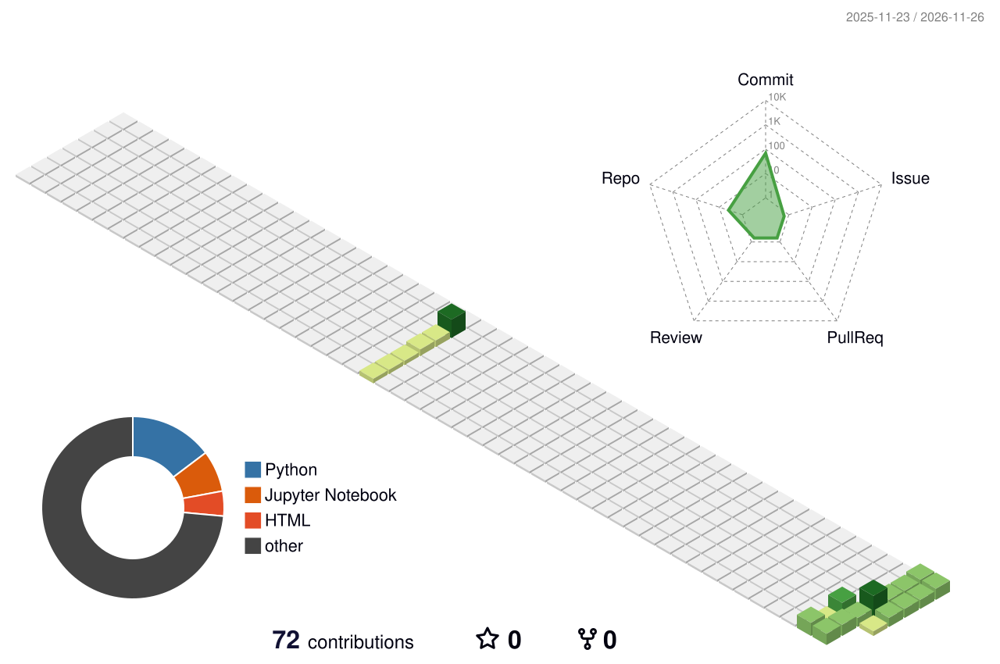

 

## 🏡 About Me

> *"It's a dangerous business, going out your door..."* — but the code is worth it.

| | |
|---|---|
| 🗡️ **Current Project** | [Basic MongoDB Flask Project](https://github.com/fleur12/basic-mongo-flask) |
| 📜 **Currently Learning** | Clustering (K-Means, DBSCAN), Flask REST APIs and data visualization |
| 💬 **Ask Me About** | Data analytics, data mining, machine learning, Python and Flask |
| 📬 **Contact** | Via GitHub below |

## 🛠️ Tech Stack

## 📊 GitHub Stats

 

## 🌄 Contribution Graph

*"The road goes ever on and on..."* 🌿

